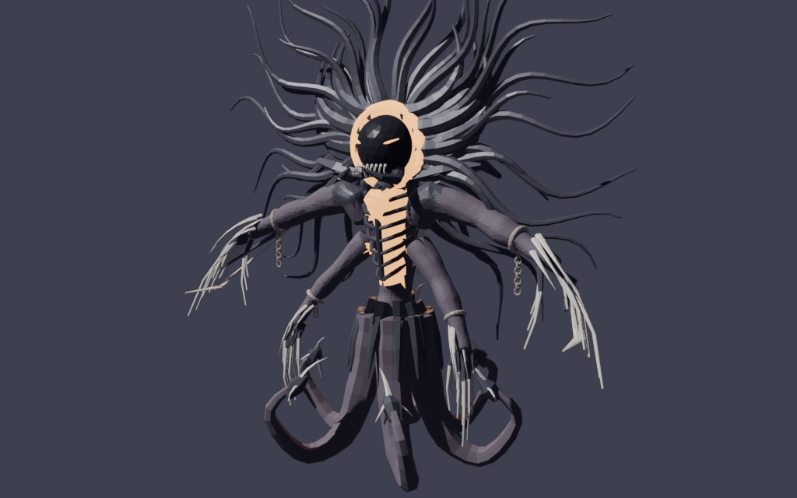
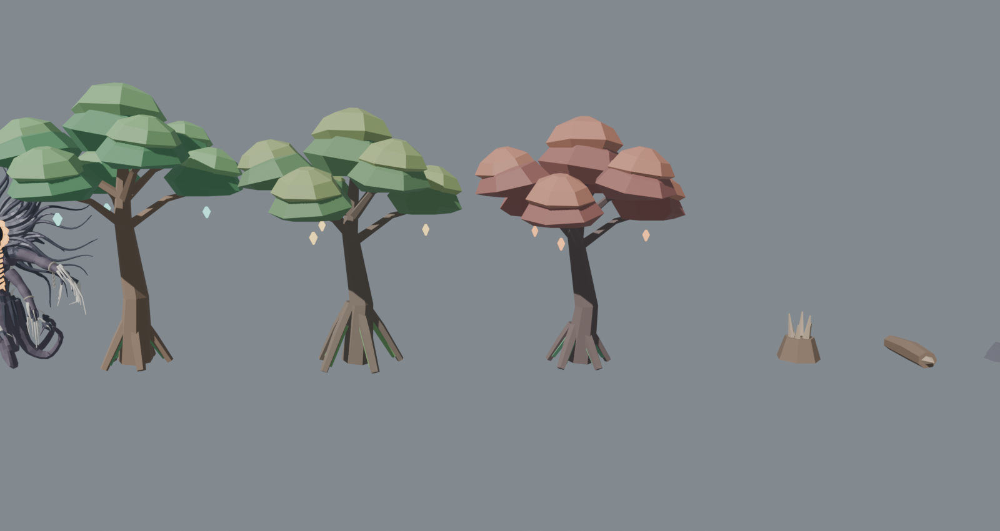
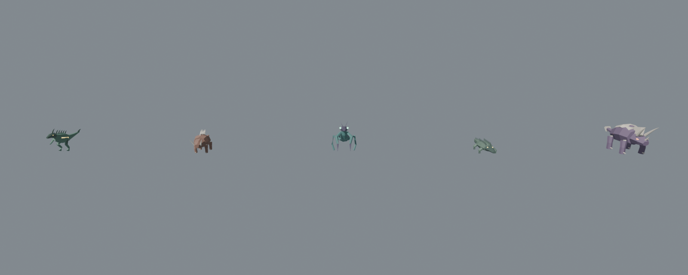

# PRIMAL HUNT — Devlog Completo & Documentação Técnica (Discord + GitHub)

> **Projeto:** `PRIMAL HUNT` (`PlaceId: 81193971554826` · `UniverseId: 10777423056` · Roblox Team Create `v149`)  
> **Desenvolvedores:** Henrique Santos, Alan Vinicius e Thiago Zarotti  
> **Inspiração:** *Evolve Stage 2* (4v1 Assimétrico · Sobrevivência, Caça & Terror Tático)  
> **Pipeline:** Blender 5.3 (`bmesh` + glTF 2.0 + Eevee) → Roblox Open Cloud Assets API → Luau (`--!strict`)

---

## Parte 1 — Resumo Pronto para Discord (Copiar & Colar)

```markdown
# 🦖 PRIMAL HUNT — MEGA UPDATE: MONSTRO COLOSSAL, DESTRUIÇÃO, 10 ESPÉCIES DE FAUNA & CICLO DIA/NOITE!

Fala pessoal! O projeto **PRIMAL HUNT**, desenvolvido por **Henrique Santos, Alan Vinicius e Thiago Zarotti** inspirado no clássico **Evolve Stage 2**, acaba de receber a maior atualização técnica e visual até o momento!

Confira tudo que foi implementado diretamente no Roblox Studio com pipeline 3D e animação feitos no Blender:

### 🏛️ Lobby 3D & Testabilidade
- Novo **Lobby 3D Completo** modelado no Blender com o Monstro como peça central de contenção e **4 plataformas individuais de classes** para os Caçadores (`Assault`, `Trapper`, `Medic`, `Support`).
- Seleção interativa por placas (`TargetRole`) e suporte a **Playtest Solo no Studio** para testar o jogo completo diretamente na Arena.

### 👹 O Monstro Colossal (22 → 38.5 Studs) & Combate Brutal
- Modelo articulado de **17 juntas (`Motor6D`)** e **100 `MeshPart`s**, com anatomia predatória reforçada no Blender:
  - Mandíbulas divididas + presas na garganta e olhos neon brilhantes;
  - Lâminas curvas de executor nos antebraços + garras em gancho superiores e inferiores;
  - Espinhos vertebrais dorsais e tentáculos terminando em arpões farpados.
- **Escala imponente em combate:** `22.0` studs no Estágio 1 (~`27.8`m topo da coroa), `~29.7` studs no Estágio 2 (`1.35x`) e `~38.5` studs no Estágio 3 (`1.75x`).
- **Status escalados:** `1500 HP / 800 Armadura` → `2600 / 1500` → `4200 / 2500`.
- **Combo M1 de 3 Golpes (`SlashCombo` 1 → 2 → 3):** corte direito, corte cruzado esquerdo e esmagamento duplo aéreo com onda de choque radial.
- Animações procedurais de **60 FPS** (`Stepped`) com respiração pesada, passadas sísmicas, investida, baforada ácida, escalada e furtividade.

### 💥 Destruição Dinâmica de Cenário (`MonsterDestructionServer`)
- Agora o Monstro **destrói árvores e totens durante ataques ou atropelamento em corrida!**
- Árvores estilhaçadas viram **tocos quebrados 3D do Blender (`ShatteredTreeStump3D`)** e arremessam **toras voadoras (`SplinteredLogChunk3D`)** com partículas de folhas/lascas, áudio de impacto e regeneração natural da floresta após `40s`.

### 🥚 Evolução Obrigatória no Ninho & 4 Cutscenes 3D
- Encher `100%` de Energia de Evolução não basta mais evoluir no meio do nada: agora é obrigatório **retornar a um dos 5 Ninhos Abissais 3D** (`<= 34` studs).
- Ao atingir `100%`, um **Feixe Localizador Rubro-Dourado (`MonsterNestHomingBeacon`)** aponta o Ninho mais próximo. Segurar `[V]` no Ninho invoca o casulo de metamorfose (`5s`) com restauração total da armadura.
- **Novo `CinematicCutsceneDirector`** com letterbox widescreen e câmera `Scriptable`:
  1. Despertar do Monstro na saída da gruta;
  2. Inserção Orbital de Dropship A.E.M. dos Caçadores (nave 3D + propulsores + cabos);
  3. Metamorfose no Ninho & revelação do Estágio 2/3;
  4. Alerta de Morte Súbita (`Estágio 3`) e encerramento da partida (`PostMatch`).

### 🦎 10 Espécies de Fauna 3D Articuladas + Animações a 60 FPS + Fix de Chão
- Resolvido o bug de bichos flutuando: substituímos `WeldConstraint`s por `Weld`s rígidos explícitos, calibramos `ExactGroundY` por espécie, migramos movimento para `Model:PivotTo` e travamos raycast no `Workspace.Terrain` (`54` pontos de spawn).
- **10 espécies únicas** com modelos no Blender, escala aumentada (`1.55x–1.7x`), sons e IA/animações próprias a **60 FPS**:
  - *Novas v5:* `SwampStalkerRaptor` (bípede ágil), `ThornbackBoar` (javali de espinhos e presas), `BiolumMantisStalker` (louva-a-deus gigante com foices), `MireCrocoSnapper` (crocodilo de pântano rastejante) e `HornedCeratopsBull` (colosso tri-chifrudo).
  - *Ecossistema v3:* `RedGoliath`, `CoastalScavenger`, `SporeCrawler` (rajada tóxica), `AcidSpitterDrake` (cuspe ácido à distância) e `ObsidianCragback` (pisão de magma).

### 🧭 Sonar Olfativo (`[Q]`) Corrigido
- Ordenação por distância destacando apenas as **18 presas + 4 Caçadores mais próximos** (abaixo do limite de 31 Highlights do Roblox), tags `AlwaysOnTop` com distância e carne nas 10 mais próximas, **3 trilhas `Beam` luminosas** guiando até a comida e anel expansivo no chão (`260` studs).

### 🌗 Ciclo Dinâmico de Dia e Noite, Floresta Colorida & Iluminação Legível
- **Ciclo completo de 24h a cada 3 minutos (`180s`)**: `DIA DE CAÇA` → `CREPÚSCULO` → `NOITE ABISSAL` → `ALVORADA RUBRA`, mantendo visibilidade clara mesmo à noite (`Brightness >= 1.90`), lanterna tática automática nos Caçadores e visão noturna no Monstro.
- **Floresta e mapa vivos:** `184` troncos cinzas antigos recoloridos e cobertos por copas 3D coloridas (verde-esmeralda, musgo e carmesim), `527` arbustos coloridos, `45` árvores 3D completas extras, `5` Ninhos Abissais, `14` Postos A.E.M. arruinados, `22` Totens de Osso e `36` Árvores de Esporos.
```

---

## Parte 2 — Previews Visuais (Blender)





---

## Parte 3 — Documentação Técnica para GitHub

### 1. Pipeline 3D & Registro de Assets (Open Cloud)

Todos os `.glb` são exportados do Blender 5.3 com um cubo marcador `ORIGIN_MARKER` em `(0, 0, 0)`. Ao importar em modo `Edit` no Roblox Studio, cada `MeshPart` utiliza `ORIGIN_MARKER.CFrame:ToObjectSpace(part.CFrame)`, garantindo orientação em `-Z` frontal sem desvios.

| Versão | Foco | Script Blender | Asset ID(s) (`Approved`) |
| :--- | :--- | :--- | :--- |
| **Lobby v4** | Hangar 3D, Monstro central e 4 bases | `blender/build_roblox_lobby_3d_pack_v4.py` | `80985591191910`, `91809769665505`, `100754912184128` |
| **Articulated v1/v2** | Rest-pose limpa 17 juntas + 2 faunas base | `blender/build_articulated_monster_v2.py`, `build_articulated_monster_and_fauna_v1.py` | `127455350901635`, `76621437738318` |
| **Cruel v3** | Anatomia cruel (`14.5u`), 5 faunas e 4 props | `blender/build_cruel_monster_fauna_and_nest_v3.py` | `140586647033629`, `107844139778605` |
| **Colossal & Floresta v4** | Monstro `22.0u -> 38.5u`, 3 árvores e 3 destroços | `blender/build_colossal_monster_trees_and_destruction_v4.py` | `133536937209186`, `92553108929386` |
| **Fauna Diversa v5** | 5 novas espécies com patas em `Z=0` | `blender/build_diverse_fauna_pack_v5.py` | `114013493278369` |

---

### 2. Módulos e Scripts Modificados/Criados no Roblox Studio

#### `ServerScriptService`
- **`MonsterServer`:** Combate (`ClawSlash` em combo 1→2→3, `LeapSmash`, `FeralCharge`, `AcidBreath`, `Climb`), escalas `1.35x`/`1.75x`, status `1500/800` → `2600/1500` → `4200/2500`, rastreamento contínuo de Ninhos e validação `NearEvolutionNest` (`<= 34` studs) com `AbyssalCocoonDome`.
- **`MonsterSkinServer`:** Monta `AbyssMonsterArticulatedTemplate` (`17` `Motor6D`s + `100` `MeshPart`s com `Weld`s explícitos), emissões de estilhaço/ácido/evolução e `CameraOffset` por estágio.
- **`MonsterDestructionServer`:** Novo script de destruição ambiental em tempo real com tocos `ShatteredTreeStump3DTemplate`, toras `SplinteredLogChunk3DTemplate`, partículas, áudio e regeneração em `40s`.
- **`PreyManager`:** Gerencia `54` spawns e `10` espécies, utilizando `ExactGroundY` por template, `Model:PivotTo`, raycast restrito a `Workspace.Terrain` e mecânicas defensivas (`SporeBurst`, `AcidSpit`, `MagmaStomp`, `ScytheSlash`, `HornCharge`, `RaptorPounce`).
- **`WorldBuilder` & `MatchManager`:** `MonsterSpawns` reposicionados `+26` studs fora das paredes das cavernas, suporte ao `AbyssalEvolutionNest3DTemplate` nos 5 locais de Ninho, Playtest solo na Arena e status iniciais alinhados.

#### `StarterPlayer.StarterPlayerScripts` & `StarterCharacterScripts`
- **`MonsterAnimClient` (`StarterCharacterScripts`):** Animação procedural a `60 FPS` para todas as 17 juntas (combo de 3 golpes, metamorfose em 2 fases, passadas sísmicas) + sincronização local de `CameraMaxZoomDistance = 68` e `CameraOffset`.
- **`MonsterClient`:** Sonar `[Q]` (`18` `Highlight`s + `10` tags `BillboardGui` + `3` trilhas `Beam` + anel `260` studs), `SmellPulse.OnClientEvent`, `MonsterNestHomingBeacon` e exibição de presa próxima + fase do dia no rodapé.
- **`FaunaAnimClient`:** Animação procedural a `60 FPS` diferenciada por espécie (`SwampStalkerRaptor`, `BiolumMantisStalker`, `MireCrocoSnapper`, `ThornbackBoar`, `HornedCeratopsBull`, `SporeCrawler`, `AcidSpitterDrake`, `ObsidianCragback`, `RedGoliath`, `CoastalScavenger`).
- **`HorrorAtmosphere`:** Ciclo dinâmico Dia/Crepúsculo/Noite/Alvorada (`180s` por dia completo) mantendo visibilidade clara, integração não destrutiva com tensão de proximidade, lanterna tática dos Caçadores, luz noturna do Monstro e clima com partículas/ecos espaciais.
- **`CinematicCutsceneDirector`:** Cutscenes widescreen em 4 momentos-chave (sem alterar o HUD `TacticalHUD` / `LobbyRoleSelector`).

---

### 3. Checklist de Validação (Playtest Live)
- `get_console_output`: **0 erros de script**.
- Auditoria de chão em todos os **`54`** animais ativos (`10` espécies): **`maxClearance = 0.03` studs** (nenhum animal voando).
- Animação a `60 FPS` verificada em todas as espécies amostradas e `Lighting.ClockTime` avançando em tempo real.
- Sonar (`18` Highlights, `10` Tags, `3` Beams), combo `SlashCombo` `[1, 2, 3]`, destruição de árvore e evolução completa no Ninho validados ao vivo.
- Versão persistida no Team Create: **`v149`**.
