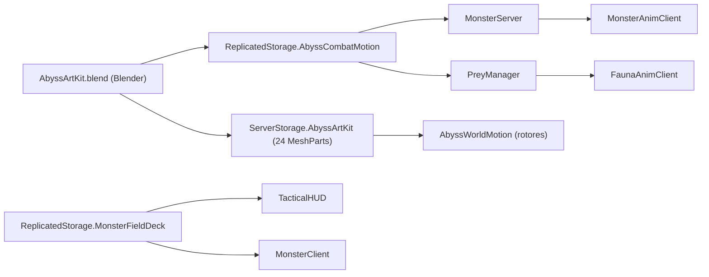

# 🦖 PRIMAL HUNT — Devlog v158: AbyssArtKit 3D, Combate Telegrafado & Deck Touch PT-BR

> **Versão:** Roblox Studio `v149 → v158` (`PlaceId: 81193971554826`)  
> **Status:** 🚧 **Em Desenvolvimento Ativo (WIP / Pre-Alpha)**  
> **Desenvolvedores:** Henrique Santos, Alan Vinicius e Thiago Zarotti  
> **Inspiração:** *Evolve Stage 2* · 4v1 Assimétrico  
> **Pipeline:** Blender (`AbyssArtKit.blend`) → Roblox Open Cloud → Luau `--!strict`

---

## Parte 1 — Resumo Pronto para Discord (Copiar & Colar)

```markdown
# 🦖 PRIMAL HUNT — UPDATE v158: KIT 3D ABISSAL, COMBATE TELEGRAFADO & JOGÁVEL NO CELULAR!

O **PRIMAL HUNT** (em desenvolvimento ativo por **Henrique Santos, Alan Vinicius e Thiago Zarotti**, inspirado em **Evolve Stage 2**) recebeu mais uma leva pesada de melhorias:

### 🎨 Novo Kit 3D "AbyssArtKit" (Blender)
- **24 novas malhas 3D** modeladas no Blender: rosto abissal e **coroas articuladas do Monstro** (Estágios 1, 2 e 3), rochas basálticas do estuário, rotores do Relé de Energia e ventiladores do hangar.
- **Cabeças esculpidas** para as **10 espécies de fauna**, com camadas de armadura + brilho/magma/veneno.

### ⚔️ Combate com Telegrafia (dá pra esquivar!)
- Monstro e animais agora **preparam o golpe antes do impacto** (curvas de animação vindas do Blender). Dá pra ler o ataque e reagir.
- Fauna com **IA de desvio de obstáculos**, linha de visão e projéteis ácidos que podem errar.
- Coroas do Monstro se movem durante os ataques.

### 📱 Novo Deck de 9 Habilidades (PC + Celular) e HUD em Português
- Garra, Salto, Carga, Ácido, Faro, Devorar, Evoluir, Furtivo e Escalar — com **toque/segure no celular** e atalhos no PC.
- HUD toda traduzida: **CAÇA, ESTÁGIO, BIOMASSA, SINAIS VITAIS, ARMADURA, VIGOR** e distância até o ninho.
- Cutscenes escondem a HUD e ganharam botão **"Pular cena"** clicável.

### 🌍 Mundo Vivo & Iluminação
- Rotores 3D girando no Relé de Energia e no hangar + **scanner de contenção** animado no lobby.
- Ciclo dia/noite **sincronizado entre todos os jogadores**; noites e terreno mais claros e legíveis.
- Novo sistema que **ajusta todos os spawns ao chão** — nada mais nascendo dentro de pedra ou árvore.
```

---

## Parte 2 — Documentação Técnica (`v149 → v158`)



### 1. Kit 3D `AbyssArtKit` (24 MeshParts do Blender)
| Grupo | Nós |
| :--- | :--- |
| Monstro | `AbyssFace_Node`, `Crown_1_L/R`, `Crown_2_L/R`, `Crown_3_L/R` |
| Fauna (10 cabeças) | `Head_Boar`, `Head_Ceratops`, `Head_Cragback`, `Head_Crawler`, `Head_Croco`, `Head_Drake`, `Head_Goliath`, `Head_Mantis`, `Head_Raptor`, `Head_Scavenger` |
| Cenário | `EstuaryBasalt_1..3`, `RelayFluxRotor`, `RelayShieldTile`, `HangarFanCasing`, `HangarFanRotor` |

- Template do Monstro (`235` descendentes) com `CrownLMotor` / `CrownRMotor` e coroas por estágio.
- `ContainmentScanner` (37 peças) no lobby com `ScanHead` pendular a 30 FPS.
- MeshIDs completos em [`studio_v158_inventory_and_artkit.json`](studio_v158_inventory_and_artkit.json).

### 2. Curvas de Combate (`AbyssCombatMotion`)
- Curvas com interpolação smoothstep exportadas do Blender.
- Fauna: `Pounce`, `Spit`, `Stomp`, `Scythe` (windup `0.36s`–`0.67s` por espécie).
- Monstro: `ClawSlash 0.13s`, `LeapSmash 0.17s`, `FeralCharge 0.19s`, `AcidBreath 0.25s`, sincronizados via `MonsterImpactAt` / `AttackImpactAt` (`GetServerTimeNow`).

### 3. IA da Fauna (`PreyManager` + `FaunaAnimClient`)
- `steer()` com `Spherecast` em 5 ângulos para desviar de obstáculos.
- Ataque pendente: windup + linha de visão + checagem de direção (`dot >= 0.68`) + recuperação de `0.26s`.
- Cuspe ácido com acerto verificado após `0.24s` (raio `4` studs).
- Suavização independente de FPS: `1 - exp(-dt * blendRate)`.

### 4. Monstro (`MonsterServer` + `MonsterAnimClient`)
- Windup aplicado antes do efeito do golpe; correção de pouso do `LeapSmash`.
- Escalada em superfícies `Climbable` custa `9` de vigor (custo checado após cálculo real).
- Câmera por estágio: zoom mínimo `32 / 40 / 46`, máximo `>= 84`, com restauração segura ao trocar de papel.

### 5. Deck Touch/PC & HUD PT-BR (`MonsterFieldDeck`, `MonsterClient`, `TacticalHUD`, `CinematicCutsceneDirector`)
- Deck responsivo de 9 slots (5 colunas no celular, 9 no PC), mira pelo centro da tela no toque.
- HUD traduzida; prompt de evolução mostra distância ao ninho.
- `AbyssCinemaActive` esconde a HUD durante cutscenes; botão "Pular cena".

### 6. Mundo, Luz & Spawns (`AbyssWorldMotion`, `SpawnGrounding`, `WorldBuilder`, `MatchManager`, `HorrorAtmosphere`, `MedicSkinServer`)
- Rotores `AbyssArtRotor` a 30 FPS com culling por distância.
- `SpawnGrounding.resolve`: raycast em 5 pontos + busca em espiral (24 anéis), presas a `75` studs dos jogadores.
- `HuntLightingEpoch` sincroniza o ciclo dia/noite pelo servidor.
- Iluminação: `EnvironmentDiffuseScale 0.36→0.58`, `WaterReflectance 0.85→0.42`, `MaxContrast 0.28→0.16`, `MaxExposureDelta -0.35→-0.17`.
- Skin do Médico: proteção contra aplicação duplicada e restauração correta de transparência.

### 7. Código no GitHub: 21 → 35 scripts ativos
Todos os scripts em [`roblox_scripts/`](roblox_scripts/) foram conferidos byte a byte (hash) com o Studio `v158`:
- **ReplicatedStorage (5):** `AEM_UIKit`, `AbyssCombatMotion`, `HunterAudio`, `HunterCombatConfig`, `MonsterFieldDeck`
- **ServerScriptService (18):** `AssaultSkinServer`, `DamageService`, `EconomyAndMonetization`, `EstuaryWildlifeTraps`, `HunterClassSkills`, `HunterCombatServer`, `HunterFieldAbilities`, `JetpackServer`, `MatchManager`, `MedicSkinServer`, `Modules/DamageService`, `MonsterDestructionServer`, `MonsterServer`, `MonsterSkinServer`, `PreyManager`, `RemoteBootstrapper`, `SpawnGrounding`, `WorldBuilder`
- **StarterCharacterScripts (3):** `AssaultAnimClient`, `MedicAnimClient`, `MonsterAnimClient`
- **StarterPlayerScripts (9):** `AbyssWorldMotion`, `CinematicCutsceneDirector`, `FaunaAnimClient`, `HorrorAtmosphere`, `HunterCombatClient`, `JetpackController`, `LobbyRoleSelector`, `MonsterClient`, `TacticalHUD`

---

<p align="center"><i>Primal Hunt © 2026 — Henrique Santos, Alan Vinicius e Thiago Zarotti. Projeto em desenvolvimento ativo.</i></p>
